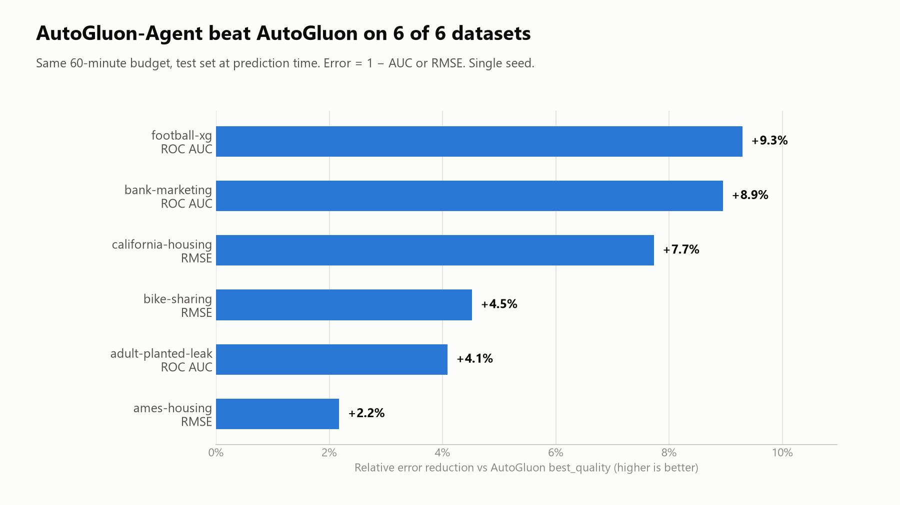
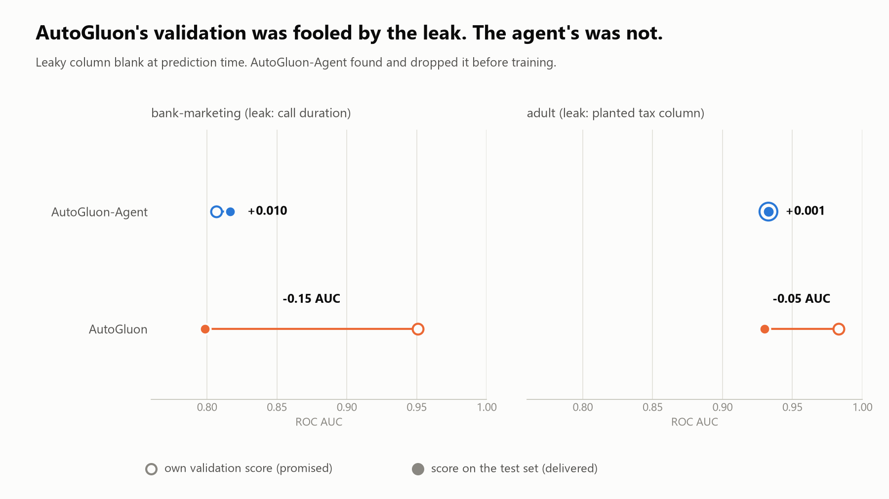

# AutoGluon-Agent

Give Claude Code a CSV and a one-line goal. Get a leakage-checked AutoGluon model, a journal of every experiment, and a report that explains what worked, what failed and why.

**Benchmark:** with the same 60-minute budget, AutoGluon-Agent beat AutoGluon `best_quality` on all six test datasets, cutting its error by 2.2% to 9.3%, at about $0.85 of Claude usage per dataset. On the two datasets with a planted leak, AutoGluon's own validation promised 0.95 and 0.98 AUC but delivered 0.80 and 0.93; AutoGluon-Agent dropped the leaky columns and its estimates were within 0.01 of the test score. Single seed, half a desktop CPU per run: see [Benchmark](#benchmark) and the [full write-up](docs/benchmark-60min-halfmachine-2026-11-07-run2/README.md).

<picture>
  <source media="(prefers-color-scheme: dark)" srcset="docs/images/error-reduction-dark.png">
  
</picture>

> [!NOTE]
> **Time-ordered data:** check the framing. The agent decides between a time split and random rows, and records why in `FRAMING.md`. On the one time-series dataset in the benchmark (bike-sharing) it chose the time split and won both 60-minute runs, with an error estimate that was pessimistic rather than optimistic. An [earlier preview](docs/benchmark-preview-2026-10-30/README.md) showed how a wrong framing makes the estimate far too optimistic, so read `FRAMING.md` before trusting a score on time-ordered data.

AutoGluon-Agent is an independent project built on [AutoGluon](https://github.com/autogluon/autogluon); it is not affiliated with or endorsed by the AutoGluon team.

## Why

AutoML engines such as AutoGluon already do model search, tuning and ensembling better than a person (or an agent) can by hand. AutoGluon-Agent keeps AutoGluon as the engine and adds what AutoML cannot do:

- **Reason about the domain.** Invent features from first principles, such as shot distance and angle to goal, instead of hoping the model rediscovers them.
- **Hunt leakage.** Notice that a column is only known after the outcome, before it inflates the score.
- **Explain.** Say why the model works, how far to trust it and what failed, instead of shipping a black box.

## Install

Install the Claude Code plugin:

```
/plugin marketplace add MaxPignatti/AutoGluon-Agent
/plugin install autogluon-agent@autogluon-agent
```

Install the `aga` harness that the plugin drives (needs Python 3.10 to 3.13; uv downloads 3.13 if necessary):

```
uv tool install --python 3.13 autogluon-agent
```

`autogluon-agent` is not on PyPI yet. Until it is, install from GitHub:

```
uv tool install --python 3.13 git+https://github.com/MaxPignatti/AutoGluon-Agent
```

The install includes every AutoGluon model family the benchmark used: LightGBM, CatBoost, XGBoost, random forests and the fastai/PyTorch neural networks. It is a large download, mostly PyTorch (on Linux the default PyTorch wheel includes CUDA). To update an existing install, add `--reinstall` to the same command.

If `aga` is missing when you run the skill, it tries to install the harness itself.

## Quickstart

In Claude Code, from the directory that holds your data:

```
/aga data.csv "predict whether the shot is a goal"
```

An optional third argument sets the time budget in minutes (default 60):

```
/aga data.csv "predict whether the shot is a goal" 30
```

The harness writes run state to `.aga/`. Next to your data you get `FRAMING.md` (how the problem was framed), `NARRATIVE.md` (the agent's interpretation) and `REPORT.md` (the full report built from the journal).

## How it works

The agent follows six phases (`skills/autogluon-agent/SKILL.md`). Each phase ends with a journal entry holding its reasoning.

1. **Frame.** `aga init` profiles the data, infers task type, metric and split, locks away a holdout and starts the budget clock. The agent writes `FRAMING.md`: what a row is, when the prediction is made in reality, which columns are known at that moment, and the group or time structure.
2. **Hunt leakage.** `aga leakage` runs automated checks (single-feature power, suspicious names, ID-like columns, duplicates, post-prediction timestamps, missingness as signal, adversarial validation). Every critical finding must be resolved with `aga drop` or `aga keep` plus a reason before anything else runs.
3. **Baseline.** `aga baseline` scores a dummy model and default LightGBM in cross-validation.
4. **Feature-engineering loop.** The agent states a domain hypothesis, writes a feature module and tests it with `aga try`. Rounds go from domain features to interactions, group and time aggregates, and encodings. The loop stops after three rounds in a row with no accepted module, or at about 40% of the budget.
5. **Final fit.** `aga fit` runs an AutoGluon `best_quality` fit on the accepted feature set and the training portion, with half the remaining budget.
6. **Verify, refit and report.** `aga evaluate` scores the holdout once; that score is the honest estimate. `aga refit` then trains the delivered model with the same recipe on all labelled rows, holdout included, and `aga report` writes `REPORT.md` with top features, the CV-versus-holdout gap, calibration, leakage decisions, what failed and a decision log of the agent's notes.

### Harness guarantees

The `aga` harness, not the agent, owns splitting, scoring and the holdout, so a careless step cannot inflate the score:

- **Locked holdout.** The holdout is split off at `aga init` and only `aga evaluate` reads it. A second evaluation needs `--force` and is flagged "holdout reused" in the report. `aga refit` trains on the holdout only after the evaluation, and from then on the holdout cannot be evaluated at all.
- **Leakage-aware splits.** Random (stratified for classification), grouped (`--group`) or temporal (`--time`, most recent 20% held out), with cross-validation that matches the split.
- **Critical leakage blocks progress.** Unresolved critical findings block `aga baseline`, `aga try`, `aga fit` and `aga refit`.
- **A fixed keep/reject rule.** A feature module is accepted only if its mean paired per-fold improvement on identical folds exceeds one standard error. The trial count is recorded and shown in the report.
- **Contract checks.** Feature modules are fit on the training fold only. A module that changes the row count or index, raises an error, or produces a column that tracks the target on the training fold but not on the validation fold is rejected, not crashed on.
- **An append-only journal.** Every decision and result is logged and feeds the report.
- **A budget.** Every command prints the remaining budget, and the final fit is sized from what is left.

## Benchmark

AutoGluon-Agent is compared with AutoGluon `best_quality` on raw features, under the same 1-hour wall-clock budget per dataset, on public datasets that include a leakage track. The agent receives only `train.csv`, the target name and a one-line goal, and the test set is kept outside its working directory (not a sandbox: the agent's transcript is saved with every run so access can be checked).

Current results: [run 2, 2026-11-07](docs/benchmark-60min-halfmachine-2026-11-07-run2/README.md), production test set (leaky columns blank, as at prediction time), with every AutoGluon model family installed (LightGBM, CatBoost, XGBoost, random forests, fastai and torch neural nets). Caveat: each system ran on half the machine (3 cores / 6 threads of a Ryzen 5 9600X, 14 GB). [Run 1](docs/benchmark-60min-halfmachine-2026-11-04/README.md), without CatBoost, XGBoost or neural models, gave larger margins (+5.8% to +12.6%); the extra models helped AutoGluon more than AutoGluon-Agent. Relative error reduction is positive when AutoGluon-Agent's error is lower; the CV-vs-test gap is test score minus the system's own validation score.

<picture>
  <source media="(prefers-color-scheme: dark)" srcset="docs/images/promised-vs-delivered-dark.png">
  
</picture>

Charts are generated from the scored results by `benchmark/charts.py`.

<!-- BENCHMARK:START -->
| Dataset | Task | Metric | AutoGluon (test) | AutoGluon-Agent (test) | Absolute difference | Relative error reduction | CV-vs-test gap (AutoGluon / AutoGluon-Agent) | Wall-clock min (AutoGluon / AutoGluon-Agent) | Claude cost (USD) |
|---|---|---|---|---|---|---|---|---|---|
| football-xg | binary | roc_auc | 0.8109 | 0.8285 | +0.0176 | +9.3% | 0.0128 / 0.0077 | 58.4 / 56.2 | 0.95 |
| ames-housing | regression | rmse | 27581.7750 | 26982.0159 | -599.7591 | +2.2% | 4254.9549 / 2277.4982 | 58.1 / 54.7 | 0.81 |
| california-housing | regression | rmse | 0.4152 | 0.3831 | -0.0321 | +7.7% | -0.0088 / -0.0160 | 58.2 / 56.0 | 0.87 |
| bike-sharing | regression | rmse | 64.9505 | 62.0162 | -2.9343 | +4.5% | 35.6841 / 15.7375 | 58.4 / 37.5 | 0.91 |
| bank-marketing | binary | roc_auc | 0.7986 | 0.8166 | +0.0180 | +8.9% | -0.1522 / 0.0099 | 58.4 / 52.1 | 0.76 |
| adult-planted-leak | binary | roc_auc | 0.9300 | 0.9328 | +0.0029 | +4.1% | -0.0530 / 0.0012 | 58.1 / 51.8 | 0.77 |
<!-- BENCHMARK:END -->

## Honesty notes

- **Single seed.** Each result is one run with one seed. Differences between the two systems can be noise. A multi-seed benchmark is planned for a later version.
- **Same training data, separate estimate.** The AutoGluon baseline and AutoGluon-Agent's delivered model both train on 100% of `train.csv`: AutoGluon-Agent refits its final recipe on all labelled rows after its one-shot holdout evaluation. AutoGluon-Agent's own error estimate comes from its model trained on the other 80% and scored once on its locked 20% holdout.
- **Leakage-track scoring.** For the two leakage datasets the test set simulates prediction-time availability: the leaky column is missing from the test data, as it would be in production. The linked results also report the "naive" scores, where the leaky column is present in the test data: there AutoGluon, which trained on the leaky column, scores higher (0.958 vs 0.817 on bank-marketing, 0.984 vs 0.933 on adult), a score that cannot be reached in production.
- **Real numbers only.** The headline will be whatever the benchmark produces, favourable or not.

## Data attribution

The benchmark uses six public datasets, subject to their own terms (recorded in `benchmark/registry.yaml`):

- **StatsBomb open data** (football shots). The data is provided by StatsBomb. StatsBomb's terms require attributing StatsBomb as the source and showing the StatsBomb logo on any analysis, release or publication that uses the data. See <https://github.com/statsbomb/open-data> for the current terms and the logo.
- **Ames housing**, retrieved via OpenML (data id 42165, `house_prices`). De Cock, D. (2011), "Ames, Iowa: Alternative to the Boston Housing Data as an End of Semester Regression Project", Journal of Statistics Education 19(3). OpenML states no licence for this dataset; it was published for educational use.
- **California housing**, retrieved via scikit-learn (`fetch_california_housing`). Derived from the 1990 U.S. Census (public domain). Pace, R. K. and Barry, R. (1997), "Sparse Spatial Autoregressions", Statistics and Probability Letters 33, 291-297.
- **Bike Sharing** (UCI Machine Learning Repository), licensed under CC BY 4.0. Fanaee-T, H. and Gama, J. (2013), "Event labeling combining ensemble detectors and background knowledge", Progress in Artificial Intelligence.
- **Bank Marketing** (UCI Machine Learning Repository), licensed under CC BY 4.0. Moro, S., Cortez, P. and Rita, P. (2014), "A data-driven approach to predict the success of bank telemarketing", Decision Support Systems.
- **Adult** (UCI Machine Learning Repository), licensed under CC BY 4.0. Becker, B. and Kohavi, R. (1996). The `tax_bracket_following_year` column is synthetic and planted by this benchmark.

Credit for the UCI datasets: the UCI Machine Learning Repository and the original dataset authors.

## License

Apache License 2.0. See [LICENSE](LICENSE). Copyright 2026 Massimo Pignatti.
